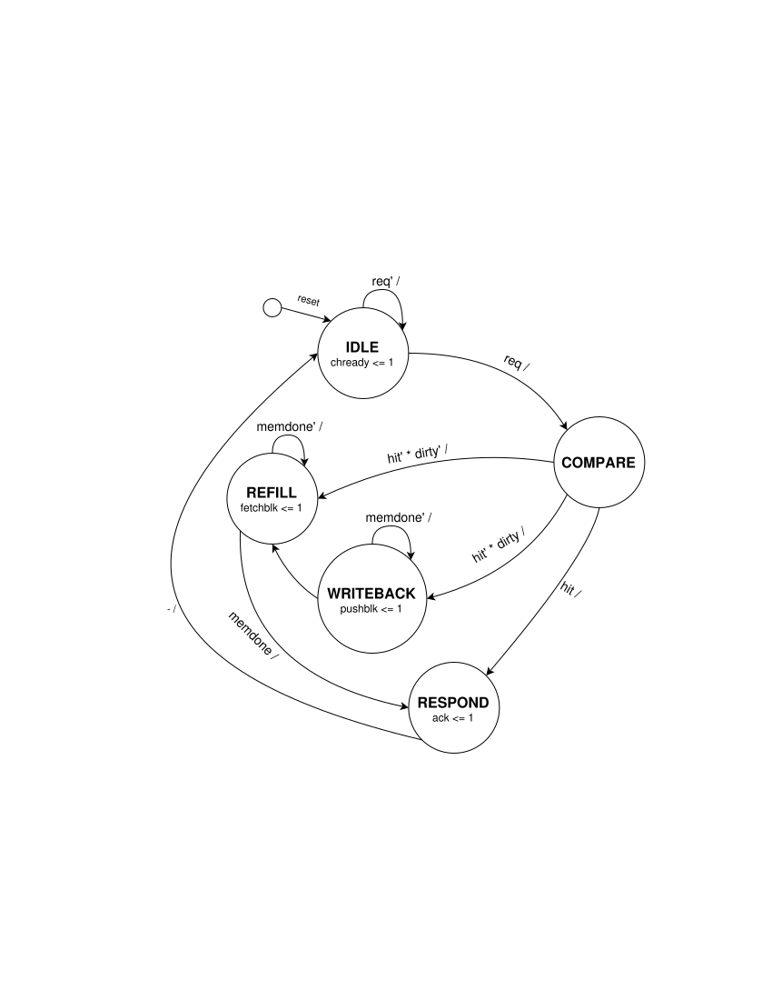

# Parameterizable Cache for the Wildcat RV32 core


one-line tagline · badges (Chisel 6 · Scala 2.13 · Nexys A7 · course code)

## Highlights
  5–7 bullets: parameterizable (capacity/line/policy), WB+WT, on-board stats over UART,
  model-checked tests, measured numbers (one headline result)
  [fig] hero: LEDs/board photo or UART stats screenshot

## Quick start
# Tests and continuous integration
Run the complete standalone cache suite from the repository root:

```bash
cd wildcat
sbt -batch test
```

Run the self-contained CPU suites from the repository root:

```bash
cd wildcat
sbt -batch "testOnly wildcat.RegisterFileTest wildcat.DataMemoryStallTest"

# Generation of the cache + cache-adapter working on the ThreeCats core of the Wildcat RV32 architecture.
Generate the SystemVerilog file "LittleCat.sv" before synthesis inside wildcat/generated/ :
make APP=asm/bench/<BENCHMARK> POLICY=<WRITE-POLICY> CAPACITY=<CAPACITY> LINESIZE=<LINESIZE> hw-asic

Recall to replace the annotated <> with your specified parameters before running the command inside wildcat/.
These parameters are by default constrained in the following way:
- POLICY: wt, wb
- CAPACITY: uint<CAPACITY> should be a power of two. The capacity parameter is utilized by the cache in Bytes.
- LINESIZE: uint<LINESIZE> should be a power of two such that LINESIZE >= 4. The equality is used as an extra constrained because the cache-lines are configured to be at least 4 bytes (one block) wide to match with the address and memory bus widths used between the CPU and Main-memory. The linesize parameter is utilized by the cache in Bytes per cache-line given that one block is at least 4 bytes wide.

*Make sure to check if the LittleCat.sv inside wildcat/generated is updated after running the generation command.

# Synthesis & Generating bitstream.
1: Synthesize the project inside of VivadSynthesize the project inside of Vivado.
2: Open synthesized design.
3: Generate the bitstream.
4: Upload the bitstream on the FPGA board.
5: Keep SW0 switched up to observe hits and misses counters [MISSES(14:8) | HITS(7:0)] via the LEDs. If SW0 is switched down, a 15 bit counter is shown. This part was only tested with the NexysA7 DDR4 board.
6: While the FPGA is executing the cache, run the stats.py file in UART/ to observe hits, misses, and hit-rates from the CLI.
7: UI STUFF COMES HERE.


## Table of contents

## 1. Overview
  1.1 Project objective and scope (what's in, what's out)
  1.2 System at a glance
      [fig] block diagram: ThreeCats → adapter → cache → memory, LED/UART side
      [tbl] memory map (0x0… RAM via cache, 0xF001… LEDs, UART)
  1.3 Repository layout
      [tbl] folder → purpose (cache/, adapter/, device/, asm/bench/, test/)

## 2. Background
  2.1 Why a cache (locality, hit/miss, EAT formula)
  2.2 Address decomposition
      [fig] | tag | index | wordidx | byte | with bit widths for the default config
      [tbl] parameter → derived fields (numLines, tagBits, …)
  2.3 Write policies: write-through (no-allocate) vs write-back (allocate, dirty bits)
  2.4 The Wildcat core and PipeCon bus (one-shot request / ack)
      [code] PipeConIO bundle

## 3. Design
  3.1 Configuration (`CacheConfig`)
      [code] case class with requires; which params are free, which Wildcat fixes
  3.2 Interfaces
      3.2.1 Producer/consumer handshakes with Decoupled / Flipped
            [code] CacheIO; [fig] valid/ready timing
      3.2.2 CPU side (CpuReq with wmask — how sb/sh work)
      3.2.3 Main-memory side (req_refill, data_refill, req_write) and why one write channel serves both policies
      3.2.4 Statistics bundle
  3.3 The cache
      3.3.1 Storage (SyncReadMem for tag/data, Reg Vec for valid/dirty, shared write port)
      3.3.2 FSM  [fig] state diagram; [tbl] state → action → next
      3.3.3 Hit path, miss path, write-allocate merge  [code] mergeWord / replaceWord
      3.3.4 Write-back path (victim capture, beat burst)
      3.3.5 Write-through path
      3.3.6 Elaboration-time policy selection (`if (cfg.isWb)` generates different hardware)
  3.4 The adapter (PipeCon ↔ cache)
      3.4.1 Why an adapter (core-agnostic cache)
      3.4.2 CPU-side FSM; 3.4.3 memory-side FSM (burst read, write beat)
      [fig] two FSMs; [code] req_now packing
  3.5 System integration (`LittleCat`)
      address decode, LED device, stats counters, latency measurement
  3.6 Observability
      3.6.1 LEDs  3.6.2 UART stats frame  [tbl] frame format  3.6.3 host script

## 4. Parameterization
  4.1 Command-line / Makefile interface  [tbl] POLICY/CAP/LINE and defaults
  4.2 What each parameter changes in hardware
  4.3 Storage overhead model  (your formula + [tbl] for a few configs)
  4.4 Constraints and unsupported combinations (requires)

## 5. Verification
  5.1 Strategy: reference model + harness + random stimulus
      [fig] harness: CPU model / DUT / memory model with two images (mm, shadow)
  5.2 Cache unit tests  [tbl] test → property checked, both policies
  5.3 Adapter tests
  5.4 On-board self-check (wcheck.s)
  5.5 How to add a test

## 6. Benchmarks & results
  6.1 Benchmark programs  [tbl] name → access pattern → what it exposes
  6.2 Methodology (counters, EAT, how predictions were made)
  6.3 Results
      [tbl] program × config → hits/misses/hit rate, predicted vs measured
      6.3.1 line-size effect  6.3.2 capacity effect  6.3.3 WB vs WT (the 75% / 62.5% case, explained)
      6.3.4 latency: tc, tm, EAT
  6.4 Resource utilization & timing  [tbl] LUT/FF/BRAM/Fmax per config
  6.5 Discussion (incl. scratchpad-as-main-memory caveat, synthesis effort vs numLines)

## 7. Set-associative extension   (planned → becomes a design section when done)
  7.1 Changes to address split and storage  7.2 Replacement policies  7.3 Tests  7.4 Benchmarks

## 8. Development workflow
  8.1 Build flow  [fig] .s → make → sbt → .v → Vivado → .bit → UART
  8.2 Vivado project setup (source paths, XDC, the stale-source pitfall)
  8.3 Troubleshooting  [tbl] symptom → cause → fix (thin-client sbt server, OOM, stale .bit, port names)

## 9. Future work
  real DRAM instead of scratchpad · latency model · write buffer · L1/L2 hierarchy ·
  GUI (PyQt) · UART program loading · fault injection / side-channel evaluation ·
  stronger core

## 10. Project notes
  team & contributions · course · timeline/milestones · lessons learned

## References & acknowledgements
  Wildcat repo, chisel-lib, soc-comm, textbook(s)

## License


# Agile-Design-Project-Parameterized-Cache-Generator
This project implements a parameterizable optimized set associative cache using generic types in Chisel design software.

## Tests and continuous integration

Run the complete standalone cache suite from the repository root:

```bash
cd cache-generator
sbt -batch test
```

Run the self-contained CPU suites from the repository root:

```bash
cd wildcat
sbt -batch "testOnly wildcat.RegisterFileTest wildcat.DataMemoryStallTest"
```

Wildcat depends on the shared `cache-generator` project. Its compilation uses
that implementation, but sbt does not run dependency projects' tests automatically.
The [GitHub Actions workflow](.github/workflows/test.yml) therefore runs both
commands in separate jobs on every push and pull request, using Java 17 and
sbt 1.10.7. Dependencies are cached between runs.
You can also start it manually using **Actions → Cache and CPU tests → Run workflow**
once the workflow is on the default branch.

Commit and push the workflow together with the shared-cache build changes.
Local commits trigger CI only after they are pushed to GitHub.
Check results in the repository's **Actions** tab or the pull request's checks;
test reports are available as the `test-reports` and `cpu-test-reports` artifacts.
To require passing tests before merging, require both **Scala / Chisel tests**
and **CPU unit tests** in your branch protection rule or ruleset.

The CPU job covers all three register-file variants and ThreeCats waiting for a
delayed data-memory acknowledgement. It does not yet cover the CPU connected to
the write-back cache: `CacheAdapterSpec` awaits the adapter's updated interface.
The assembly/simulator suites that need `risc-v-lab` and RISC-V tools are also
outside this job. A green workflow verifies these documented suites, not the
complete hardware integration.

<p align="center">
  

<p align="center">
  
