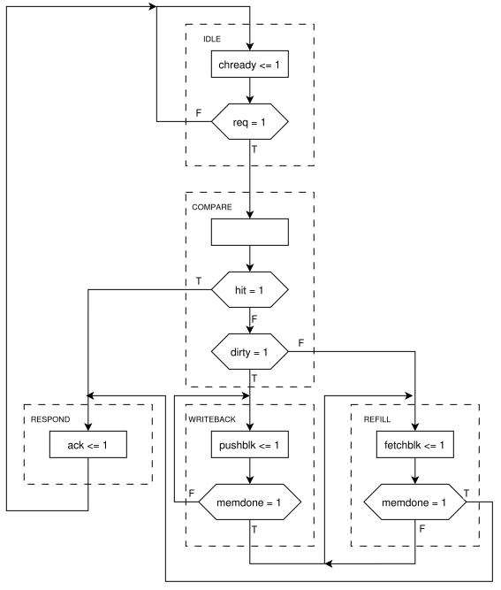

# Parameterized Cache Generator

This branch contains a reusable, parameterized set-associative cache written in Chisel.
The cache supports elaboration-time selection of write-back or write-through policy,
byte-masked stores, configurable line and bus widths, and decoupled CPU and memory
interfaces. Associativity is selected at elaboration with `CacheConfig(numWays = 4)`;
`numWays = 1` remains the direct-mapped default. Total capacity stays fixed:
`numLines = capacityBytes / lineBytes` and `numSets = numLines / numWays`.
Ways must be a positive power of two and cannot exceed the number of lines.
A single set is supported (fully associative at that capacity).

Instantiate `new SetAssociativeCache(cfg)` for any supported associativity.
`DirectMappedReadCache` remains a compatibility entry point for one-way configurations.
Each way has synchronous tag/data storage, read in parallel to preserve two-counted-cycle
hits. A miss fills the lowest invalid way first; full sets use a per-set round-robin
pointer. Installing a line advances the pointer to the following way. Hits and
write-through store misses do not advance it. Write-back stores allocate on a miss;
write-through stores do not. CPU/memory interfaces and statistics are unchanged.

## Tests and continuous integration

Run the standalone cache suite from the repository root:

```bash
cd cache-generator
sbt -batch test
```

Integration code, system-level tests, and CI are maintained on the `testing`
branch so consumers of this branch can take the cache module independently.

On `testing`, run the self-contained Wildcat integration suites with:

```bash
cd wildcat
sbt -batch "testOnly adapter.CacheAdapterSpec wildcat.RegisterFileTest wildcat.DataMemoryStallTest"
```

Generate LittleCat hardware for a benchmark and selected cache policy with:

```bash
cd wildcat
make APP=asm/bench/wcheck.s CACHE=wb hw-asic
make APP=asm/bench/wcheck.s CACHE=wt hw-asic
make APP=asm/bench/wcheck.s CACHE=wb WAYS=4 hw-asic
```

`CACHE` accepts `wb` or `wt` and defaults to `wb`; `WAYS` defaults to `1`.
The equivalent entry point is `runMain wildcat.pipeline.LittleCat a.out wb 4`.
For standalone hardware, run `sbt -batch "runMain cache.GenerateCache 4"` inside
`cache-generator/`. Omitting ways preserves the direct-mapped generation default.
Both entry points accept an optional final output directory (default `generated`).
Checked-in generated hardware snapshots are not automatically refreshed by tests;
regenerate them for the configuration being synthesized. CI runs only on pushes to
`testing`, pull requests targeting `testing`, and manual dispatches.

<p align="center">
  

<p align="center">
  
