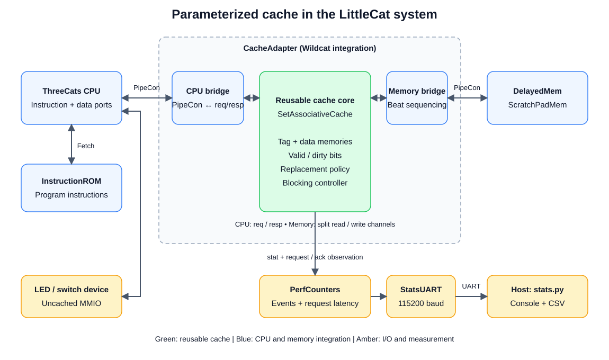
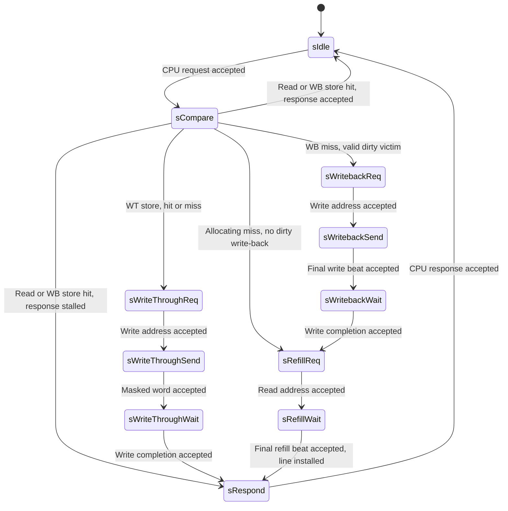

# Parameterized Cache Generator

A reusable, parameterized data cache written in Chisel for the DTU 02201 Agile Hardware Design project. The generator supports direct-mapped, set-associative, and fully associative configurations, two write policies, and three replacement policies. A Wildcat RISC-V integration provides a complete system for running programs and measuring cache behavior over UART.

The cache lives in `cache-generator/`; Wildcat depends directly on that project through SBT. There is one shared cache implementation.

## Commands

### Prerequisites

- Java 17 and SBT 1.10.7 for the Scala/Chisel builds and tests. Both projects use Scala 2.13.16, Chisel 6.7.0, and ChiselTest 6.0.0.
- Python 3 for the telemetry decoder tests; **pyserial** to read a connected board.
- RISC-V binutils to assemble programs for Wildcat. The Makefile defaults to `riscv64-elf-` on macOS and `riscv64-unknown-elf-` elsewhere.

Commands below state their working directory. Hardware generation, synthesis, and programming are separate steps.

### Run tests

From `cache-generator/`, run all standalone cache tests:

```sh
sbt -batch test
```

Run a specific suite when working on a policy:

```sh
sbt -batch "testOnly cache.SetAssociativeCacheSpec"
sbt -batch "testOnly cache.TreePLRULogicSpec cache.TreePLRUCacheSpec"
```

From `integration/wildcat/`, run the self-contained integration suites used by CI:

```sh
sbt -batch "testOnly adapter.* memory.DelayedMemSpec device.* wildcat.RegisterFileTest wildcat.DataMemoryStallTest wildcat.CachedProgramSpec"
```

From the repository root, test the UART frame decoder:

```sh
python3 -m unittest discover -s integration/UART_TB -v
```

[CI](.github/workflows/test.yml) runs these checks on pushes and pull requests. Cache tests cover replacement, masked stores, backpressure, and write completion ordering. Integration tests cover the adapter, memory latency, telemetry, and a ThreeCats program that stores, evicts, and reloads under both write policies.

### Generate a standalone cache

From `cache-generator/`:

```sh
# Direct-mapped, round-robin defaults
sbt -batch "runMain cache.GenerateCache"

# Four-way cache with tree pseudo-LRU
sbt -batch "runMain cache.GenerateCache 4 generated plru"

# Four-way cache with reproducible random replacement
sbt -batch "runMain cache.GenerateCache 4 generated random 7"
```

Argument order:

```text
[ways] [output-directory] [rr|plru|random] [seed]
```

Defaults are `1 generated rr 1`. This entry point uses **1 KiB capacity, 4-byte lines, 32-bit addresses, 4-byte words/beats, and write-back**. Change `GenerateCache` in [cache.scala](cache-generator/src/main/scala/cache.scala) or instantiate `SetAssociativeCache` with your own `CacheConfig` to change those values.

One way emits `generated/DirectMappedReadCache.sv`; multiple ways emit `generated/SetAssociativeCache.sv`. The output directory is relative to `cache-generator/` unless an absolute path is supplied.

Optional synthesis statistics for the default one-way output, with Yosys installed:

```sh
yosys -p 'read_verilog -sv generated/DirectMappedReadCache.sv; synth -top DirectMappedReadCache; stat'
```

### Build a Wildcat program and generate the system

From `integration/wildcat/`:

```sh
# Assemble and link a benchmark into a.out
make APP=asm/bench/wcheck.s app

# Run the ELF program in the instruction-set simulator
make PROGRAM=a.out run

# Generate LittleCat with a four-way write-back cache
make APP=asm/bench/wcheck.s POLICY=wb WAYS=4 REPLACEMENT=plru hw-asic

# Generate a write-through system with added memory latency
make APP=asm/bench/wcheck.s POLICY=wt WAYS=2 REPLACEMENT=random SEED=7 MEMLATENCY=3 hw-asic
```

`hw-asic` generates the LittleCat RTL used by the FPGA synthesis target too. It first builds `APP`, then writes `generated/LittleCat.sv` by default. `make dump` disassembles `a.out`.

| Make variable   | Default        | Meaning                                       |
| --------------- | -------------- | --------------------------------------------- |
| `APP`         | `asm/play.s` | Assembly benchmark program to build                    |
| `POLICY`      | `wb`         | `wb` (write-back) or `wt` (write-through) |
| `CAPACITY`    | `4096`       | Total cache data capacity in bytes            |
| `LINESIZE`    | `16`         | Bytes per cache line                          |
| `WAYS`        | `1`          | Ways per set                                  |
| `REPLACEMENT` | `rr`         | `rr`, `plru`, or `random`               |
| `SEED`        | `1`          | Nonzero random replacement seed               |
| `MEMLATENCY`  | `0`          | Extra delay per backing-memory transaction in cycles   |
| `MEMBYTES`    | `16384`      | Main memory data size in bytes             |
| `OUTDIR`      | `generated`  | RTL output directory                          |

For an already built program, invoke the generator directly:

```sh
sbt -batch "runMain wildcat.pipeline.LittleCat a.out wb 4096 16 4 plru 1 0 16384 generated"
```

```text
program [wb|wt] [capacity] [line-size] [ways] [rr|plru|random] [seed] [memory-latency] [memory-bytes] [output-directory]
```

### Read telemetry

From the repository root, with pyserial installed:

```sh
python3 integration/UART_TB/stats.py --port /dev/ttyUSB1 --csv results.csv

# Record a timed experiment and attach its configuration to every CSV row
python3 integration/UART_TB/stats.py --port /dev/ttyUSB1 --csv results.csv --seconds 30 --tag wb-4way-plru
```

Replace the port with the board's serial device. The reader uses **115200 baud** and reports interval hit rate, hit/miss latency, average memory access time (AMAT), and controller-state occupancy.

## Overall architecture



The reusable cache exposes decoupled request/response channels. In LittleCat, `CacheAdapter` translates the CPU's PipeCon requests into those channels and converts cache memory transactions back into individual PipeCon transfers. Instruction fetches use a separate ROM; memory-mapped I/O bypasses the data cache. Cache events feed performance counters and the UART transmitter.

## Cache configuration

The public configuration and interfaces are defined in [model.scala](cache-generator/src/main/scala/model.scala). For example, from a Chisel module:

```scala
import cache._
import chisel3._

val cache = Module(new SetAssociativeCache(CacheConfig(
  capacityBytes = 4096,
  lineBytes = 16,
  numWays = 4,
  writePolicy = WriteBack,
  replacementPolicy = TreePLRU
)))
```

| `CacheConfig` field | Default        | Purpose                                    |
| --------------------- | -------------- | ------------------------------------------ |
| `capacityBytes`     | `4096`       | Data capacity, excluding tags and metadata |
| `addrWidth`         | `32`         | Address width in bits                      |
| `lineBytes`         | `16`         | Bytes per line                             |
| `wordBytes`         | `4`          | CPU word width in bytes                    |
| `memBeatBytes`      | `4`          | Memory transfer width in bytes             |
| `writePolicy`       | `WriteBack`  | Store and allocation behavior              |
| `numWays`           | `1`          | Associativity                              |
| `replacementPolicy` | `RoundRobin` | Victim-selection policy                    |
| `lfsrSeed`          | `1`          | Seed for random replacement                |

These are the **library defaults**; the standalone CLI uses the smaller geometry described above.

Geometry follows:

```text
numLines     = capacityBytes / lineBytes
numSets      = numLines / numWays
wordsPerLine = lineBytes / wordBytes
beatsPerLine = lineBytes / memBeatBytes
address      = [ tag | set index | line offset ]
```

Capacity, line size, word size, beat size, and associativity must be powers of two. A line must hold at least one word and one beat, and capacity must hold at least two lines. Ways cannot exceed the total number of lines. `numWays = 1` is direct-mapped; `numWays = numLines` is fully associative, with no set-index bits. Increasing associativity keeps total data capacity fixed.

Write-through requires `memBeatBytes == wordBytes`. The Wildcat adapter additionally requires 32-bit addresses and 4-byte words/beats. `MEMLATENCY` must be nonnegative and `MEMBYTES` a positive power of two.

`DirectMappedReadCache` is a compatibility entry point for one-way configurations. Despite its historical name, it uses the shared implementation and supports stores.

## Behavior and design choices

### Blocking controller and synchronous storage

The cache accepts one CPU request at a time. Each way has synchronous tag and data memories; valid and dirty bits are registers. A request starts the memory lookup, then the controller compares tags in `sCompare`. Read hits and write-back store hits can respond in that state. If the CPU stalls the response, the result is held in `sRespond`.

This organization keeps miss handling sequential: select a victim, complete any dirty write-back, refill the entire line, and respond. There are no overlapping misses or early responses before a refill completes. Store hits and refills share one data-memory write port per way.

### Controller finite-state machine

The controller is defined in [cache.scala](cache-generator/src/main/scala/cache.scala), with the eleven canonical states declared in [model.scala](cache-generator/src/main/scala/model.scala). Reset enters `sIdle` and clears valid bits, dirty bits, and replacement metadata to their configured initial values. Tag and data memories do not need a reset because a line cannot hit until its valid bit is set.



Here, an **allocating miss** is any load miss or a write-back store miss. A write-through store miss follows the write-through path without refilling. The diagram omits self-loops: request and completion states wait for their channel handshake; beat-transfer states stay active until the final beat transfers.

| State                 | Hardware action                                                                                                                            | Condition to leave                        |
| --------------------- | ------------------------------------------------------------------------------------------------------------------------------------------ | ----------------------------------------- |
| `sIdle`             | Assert CPU `req.ready`; on acceptance, latch address, operation, store data, and mask, and read every way's tag/data at the selected set | `req.fire`                              |
| `sCompare`          | Compare valid tags in parallel, select the hit or victim way, update a store hit, and choose the hit/miss path                             | Always leaves after this comparison cycle |
| `sWritebackReq`     | Present the captured dirty victim's line-base address on `memWriteReq`                                                                   | Write-address handshake                   |
| `sWritebackSend`    | Stream the captured victim line with all byte-mask bits set; advance the beat counter only on acceptance                                   | Final write-data handshake                |
| `sWritebackWait`    | Accept explicit write completion, require `ack = true`, clear the victim's dirty bit, and pulse `stat.writeback`                       | Write-completion handshake                |
| `sWriteThroughReq`  | Present the stored CPU request's word-aligned address on `memWriteReq`                                                                   | Write-address handshake                   |
| `sWriteThroughSend` | Send one word with the original CPU byte mask                                                                                              | Write-data handshake                      |
| `sWriteThroughWait` | Accept explicit write completion, require `ack = true`, prepare a zero response, and pulse `stat.writeThrough`                         | Write-completion handshake                |
| `sRefillReq`        | Present the requested line-base address on `memReq`; reset the refill beat counter when accepted                                         | Read-address handshake                    |
| `sRefillWait`       | Collect ordered beats; on the last beat, install data/tag, set valid/dirty metadata, update replacement state, and prepare the response    | Final read-data handshake                 |
| `sRespond`          | Hold response data and `resp.valid` until the CPU accepts it                                                                             | `resp.fire`                             |

`fire` means `valid && ready`. The cache asserts `req.ready` only in `sIdle`, so it cannot accept another request during a miss, memory write, or stalled CPU response. `stat.hit` or `stat.miss` pulses during `sCompare`, once per lookup, rather than once per waiting cycle.

For a hit, the synchronous lookup begins when the request is accepted; the response can transfer in the following compare cycle. A miss adds address handshakes, data beats, any memory stalls, and a final response cycle. The dirty-eviction and refill paths execute sequentially. These core timings exclude the Wildcat adapter and CPU stalls.

### Storage and datapath hardware

Each way contains one `SyncReadMem(numSets, tagBits)` for tags and one `SyncReadMem(numSets, lineBits)` for whole cache lines. All ways read the same set in parallel. One tag comparator per way produces a hit vector; an OR reduction detects a hit and a priority encoder selects the hit way. Another priority encoder selects the lowest-index invalid way before the configured replacement policy is consulted.

The selected way feeds tag and line multiplexers. A word multiplexer selects the CPU response word from the line. For a store, byte-level multiplexers merge `writeData` into that word according to `writeMask`, then reassemble the line. Store hits and refills use the same write port in each way, with the write enable selecting only the target way. Tags are written when a refill installs a line.

The controller also owns request registers, a response-data register, a victim-way register, a beat counter, a full-line eviction register, and a full-line refill buffer. Capturing the dirty victim's address and line in `sCompare` preserves the synchronous-memory outputs throughout a stalled write-back. On the final refill beat, the installation logic combines the buffered beats with the incoming beat directly, so it does not read an old value from the buffer register.

For the common **4 KiB, 16-byte line, four-way, 32-bit address** configuration:

| Hardware structure                | Logical size                                                       |
| --------------------------------- | ------------------------------------------------------------------ |
| Sets / total lines                | 64 sets / 256 lines                                                |
| Tag / index / offset              | 22 / 6 / 4 bits                                                    |
| Data arrays                       | Four memories, each 64 entries × 128 bits; 32,768 data bits total |
| Tag arrays                        | Four memories, each 64 entries × 22 bits; 5,632 tag bits total    |
| Valid / dirty metadata            | 256 bits each in the source design                                 |
| Eviction register / refill buffer | 128 bits each                                                      |
| Memory beats per line             | Four 32-bit beats                                                  |

These are logical storage sizes, excluding request/control registers and combinational logic. `SyncReadMem` describes synchronous storage; the synthesis flow determines its physical mapping. Actual RAM blocks, SRAM macros, flip-flops, area, and timing must be read from the generated design's synthesis reports. For write-through, dirty bits remain false and synthesis may remove unused write-back storage and logic.

### Write policies

| Policy                 | Store hit                              | Store miss                                   | CPU store completion                   |
| ---------------------- | -------------------------------------- | -------------------------------------------- | -------------------------------------- |
| Write-back (`wb`)    | Merge masked bytes and mark dirty      | Allocate a line, merge the store, mark dirty | Once the cache has accepted the update |
| Write-through (`wt`) | Merge masked bytes and write to memory | Write to memory without allocating           | After memory acknowledges the write    |

Loads allocate on misses under both policies. Stores acknowledge with response data zero. Byte masks select the bytes to update.

Write-back defers memory traffic until a dirty line is evicted. Write-through sends every store to memory and avoids allocating lines on store misses. Dirty evictions finish before the corresponding refill starts.

#### Write-back hardware

Write-back uses one dirty bit per line. A hit store merges the masked bytes into the selected data-memory line and sets its dirty bit in `sCompare`. It can acknowledge there without a backing-memory transaction. On a store miss, the cache first obtains the whole line, merges the store into the refill data, and installs it as valid and dirty. This refill also happens for a full-word store, preserving the other words in the line.

If the selected victim is valid and dirty, its old tag and set index reconstruct the write-back address. The controller captures that address and the full victim line, then uses `beatCnt` to select successive `memBeatBytes` slices. Every byte of the line is written, even if only one byte was originally modified. Only after explicit memory completion does the controller clear the dirty bit and request the new line. A clean or invalid victim skips this write-back sequence.

For a dirty load miss with four beats per line, the path is:

```text
sIdle → sCompare → sWritebackReq → sWritebackSend (4 transfers)
      → sWritebackWait → sRefillReq → sRefillWait (4 transfers)
      → sRespond → sIdle
```

Each transfer can stall independently. A write-back store miss follows the same path but merges its pending store before installing the refill and returns zero.

#### Write-through hardware

Write-through uses the same byte-merge datapath on a store hit, but does not mark the line dirty. Both store hits and misses send the CPU's word-aligned address, store word, and byte mask through `sWriteThroughReq`, `sWriteThroughSend`, and `sWriteThroughWait`. A store miss does not modify cache data, install a tag, or update replacement state.

There is no independent store buffer: the controller waits for memory completion before acknowledging the CPU and accepting another request. The memory data beat and CPU word must have equal widths, which is why this policy requires `memBeatBytes == wordBytes`. Load misses still refill a line, but never need a dirty eviction in a write-through configuration.

```text
WT store hit or miss:
sIdle → sCompare → sWriteThroughReq → sWriteThroughSend
      → sWriteThroughWait → sRespond → sIdle
```

The write policy is a Scala configuration value resolved during elaboration. Chisel generates the selected control paths; the resulting cache has no run-time policy-switch input. The canonical state enum still names both write-policy sequences for consistent debug and telemetry decoding.

### Replacement policies

Invalid ways always fill first. Once a set is full:

| Policy                     | State                           | Update behavior                     |
| -------------------------- | ------------------------------- | ----------------------------------- |
| Round-robin (`rr`)       | One next-victim pointer per set | Advances after a refill             |
| Tree pseudo-LRU (`plru`) | `numWays - 1` bits per set    | Updates on hits and refills         |
| Random (`random`)        | One shared seeded LFSR          | Advances only on full-set evictions |

Round-robin is the default and needs little state. Tree pseudo-LRU tracks recent accesses without maintaining an exact LRU ordering. Random provides a repeatable alternative for experiments. One-way configurations omit replacement hardware.

The random seed must be nonzero and fit in `max(16, wayBits + 1)` bits, where `wayBits = max(1, log2Ceil(numWays))`.

#### Round-robin hardware

For more than one way, `nextVictim` is a reset-to-zero register vector with one `wayBits` pointer per set. Selecting a victim reads the addressed set's pointer. After a refill into way `w`, that pointer becomes `(w + 1) mod numWays`; hits leave it unchanged. This also applies when the refill used an invalid way.

Because the number of ways is a power of two, this needs a small increment/wrap datapath, with no per-access recency tracking. With 64 sets and four ways, the pointers occupy **64 × 2 = 128 bits**.

#### Tree pseudo-LRU hardware

[TreePLRULogic.scala](cache-generator/src/main/scala/TreePLRULogic.scala) builds a binary tree with ways as leaves and `numWays - 1` preference bits per set. A bit of zero points toward the left subtree for eviction; one points right. Victim selection follows those bits through a combinational mux tree.

For four ways, the three stored bits correspond to these internal nodes:

```text
                    node 0
                   /      \
              node 1      node 2
              /   \        /   \
           way 0 way 1  way 2 way 3
```

Touching a way changes only its ancestor bits, pointing each one away from the accessed subtree. For example, after a hit or refill in way 0, node 0 becomes 1 (prefer the right half) and node 1 becomes 1 (prefer way 1); node 2 keeps its previous value. Starting from all zeros, this produces packed state `011`, where the printed bit order is `[node2 node1 node0]`, and the next victim is way 2.

The cache stores the per-set bits in `plruState`; the helper itself contains combinational logic and no registers. Its Scala recursion constructs the hardware at elaboration, so walking the tree does not add one clock cycle per level. The victim path has `log2(numWays)` mux levels. Updates occur on every hit, including store hits, and on refills. With 64 sets and four ways, the metadata occupies **64 × 3 = 192 bits**.

This records which subtree was used more recently at each node. It approximates LRU without keeping a complete ordering of all ways.

#### Random replacement hardware

Random replacement instantiates a single Chisel `LFSR` shared by all sets. Its register width is `randomBits = max(16, wayBits + 1)`. The low `wayBits` bits select a way; since associativity is a power of two, no modulo divider is needed.

The LFSR advances only when `sCompare` sees a miss in a full set that will allocate a line: a load miss under either write policy, or a write-back store miss. Hits, invalid-way fills, and write-through store misses leave it unchanged. The selected victim is latched for the ongoing miss, so memory stalls do not change that decision.

For four ways, this uses **one 16-bit LFSR for the whole cache**, rather than state per set. A fixed seed reproduces the replacement sequence for the same sequence of allocating full-set misses; it is a pseudorandom hardware sequence.

#### Hardware selected at elaboration

The replacement-policy match is evaluated when generating hardware. Only the selected policy's metadata and logic are instantiated: round-robin pointers, PLRU state and tree logic, or the LFSR. A one-way configuration bypasses all three and selects way zero directly. Increasing associativity adds parallel tag comparisons and wider way-selection muxes even when total data capacity stays constant.

### Memory protocol

All public channels use `valid`/`ready`; a transfer occurs only when both are high.

| Channel          | Direction relative to cache | Payload                                                       |
| ---------------- | --------------------------- | ------------------------------------------------------------- |
| `req`          | Input                       | Address, read/write flag, store data, byte mask               |
| `resp`         | Output                      | Read word or zero-valued store acknowledgement                |
| `memReq`       | Output                      | Line-aligned refill address                                   |
| `memResp`      | Input                       | Exactly `beatsPerLine` ordered data beats                   |
| `memWriteReq`  | Output                      | Line-aligned write-back or word-aligned write-through address |
| `memWriteData` | Output                      | Data beat and byte mask                                       |
| `memWriteResp` | Input                       | Explicit write completion with `ack = true`                 |

A write address is accepted before its data. Write-back sends a whole line; write-through sends one masked word beat. Accepting the last data beat does not complete a write: memory must return `memWriteResp` after the write finishes. The adapter waits for all PipeCon beat acknowledgements before producing that completion.

The core has no PipeCon, CPU, or UART dependency. Its `stat` output provides hit, miss, write-back, and write-through event pulses plus the controller state; integration-specific counters live outside the cache.

## Wildcat integration and measurement

[LittleCat](integration/wildcat/src/main/scala/wildcat/pipeline/LittleCat.scala) connects a ThreeCats CPU, instruction ROM, cache adapter, delayed backing memory, LED device, and UART telemetry.

- Data requests in the `0x0...` address region go through the cache.
- The LED/switch device is selected in the `0xF001....` region and bypasses the cache.
- `DelayedMem` adds `MEMLATENCY` cycles to the synchronous scratchpad timing. Zero added latency still has the scratchpad's one-cycle acknowledgement; this is a per-beat delay, not a total miss penalty.
- Switch 0 selects software LED output or cache hit/miss counts; LED 15 shows a heartbeat.

The UART transmits a snapshot about every 100 ms at the default 100 MHz system frequency. A frame is `0xAA` followed by **19 little-endian 32-bit words** (77 bytes total):

```text
hits, misses, writebacks, write-throughs, stores,
hit-latency total, miss-latency total, elapsed cycles,
sIdle, sCompare, sWritebackReq, sWritebackSend, sWritebackWait,
sWriteThroughReq, sWriteThroughSend, sWriteThroughWait,
sRefillReq, sRefillWait, sRespond
```

The [host decoder](integration/UART_TB/stats.py) computes differences between snapshots and handles 32-bit counter wraparound. Its test checks state order against the canonical cache enum. Keep the FPGA image and decoder on the same frame format when changing telemetry.

# Cache Visualizer
The visualizer provides an interactive environment for simulating and analysing
cache behavior under different configurations. It supports loading benchmark
datasets, stepping through individual memory accesses to visualize independent 
response and request transactions, and comparing cache performance across 
different workloads.

## Setup
```bash
cd cache-generator && sbt clean compile publishLocal
cd ../cache-visualizer
make run
```

All dependencies are vendored!

## Interface

GUI is subdivided into two main areas:

- **Configuration and COntrols(left):** configure the cache, select worloads, 
and control simulation execution.
- **Cache Table and Comparison (right):** Inspect the internal cache state or
compare simulation results.

## Cache Configuration

Supports cache config:

| `CacheConfig` field | Default | Purpose |
| --- | --- | --- |
| `capacityBytes` | `4096` | Data capacity, excluding tags and metadata |
| `addrWidth` | `32` | Address width in bits |
| `lineBytes` | `16` | Bytes per line |
| `wordBytes` | `4` | CPU word width in bytes |
| `memBeatBytes` | `4` | Memory transfer width in bytes |
| `writePolicy` | `WriteBack` | Store and allocation behavior |
| `numWays` | `1` | Associativity |
| `replacementPolicy` | `RoundRobin` | Victim-selection policy |
| `lfsrSeed` | `1` | Seed for random replacement |

Configuration can be loaded to a locally hosted virtual simulated environment
that occupies port 9000. Any issues, please: 
```bash
lsof -i :9000
kill <pid>
```
To free port for cache utilization.

**FPGA hardware implementation pending due to uart communication**.

## Workloads

The visualizer supports three workloads:

- **Builtin:** all testbenches that can be run on the cache
- **Current Test:** preview of last current loaded set, provides saving/overwriting
of trace file
- **Trace File:** allows the user to load prexisting trace files that 
share the results from a builtin testbench. Can be used to compare already
processed testbenches.

## Simulation Controls

Provide control over the cache table for seeing the execution of a testbench.

## Statistics

The statistics panel provides an overview of simulation performance for
the current running test, including:

- Hit rate
- Total hits
- Total misses
- Evictions
- Write-backs
- Total cycles

## Cache Table

Provides a live view of cache's internal state.

It displays:
- Valid and dirty bits
- Stored words among N-ways
- Cache hit or misses(red and green)

## Comparison


## Repository layout


| Path | Contents |
| --- | --- |
| [cache-generator/src/main/scala](cache-generator/src/main/scala) | Reusable cache, configuration, interfaces, replacement logic, RTL entry point |
| [cache-generator/src/test/scala](cache-generator/src/test/scala) | Standalone cache and replacement tests |
| [integration/wildcat](integration/wildcat) | CPU, PipeCon adapter, memory models, devices, synthesis configuration, integration tests |
| [integration/UART_TB](integration/UART_TB) | Python telemetry reader and frame-layout test |
| [images](images) | Architecture and controller diagrams |
| [.github/workflows/test.yml](.github/workflows/test.yml) | Cache, integration, and telemetry CI checks |
| [cache-visualizer/data_sets](cache-visualizer/data_sets) | Cache benchmarks |
| [cache-visualizer/hardware](cache-visualizer/hardware) | Cache wrapper for virtual session |

Develop both projects on `main` through short-lived feature branches; this layout does not require a separate long-lived integration branch.
