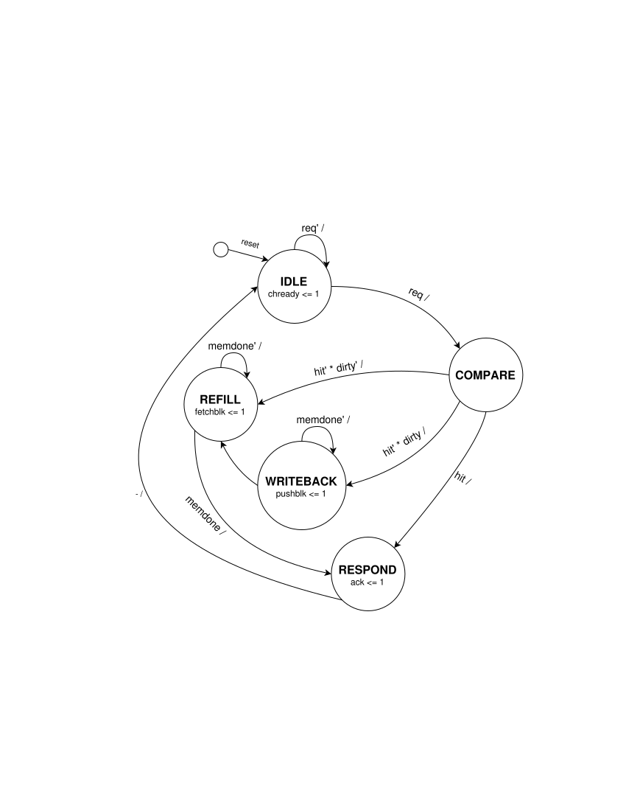
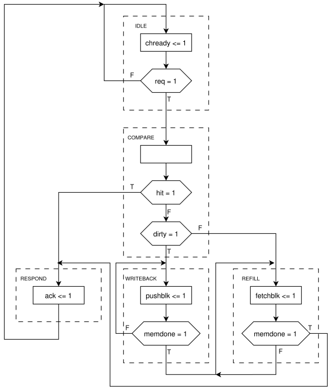

# Agile-Design-Project-Parameterized-Cache-Generator
This project implements a parameterizable optimized set associative cache using generic types in Chisel design software.

## Tests and continuous integration

Run the Scala/Chisel test suite from the repository root:

```bash
cd cache-generator
sbt -batch test
```

The [GitHub Actions workflow](.github/workflows/test.yml) runs this command on
every push and pull request, using Java 17 and the sbt version pinned in
`cache-generator/project/build.properties`. Dependencies are cached between runs.
You can also start it manually using **Actions → Cache tests → Run workflow**
once the workflow is on the default branch.

Commit and push the workflow, `.gitignore`, and `cache-generator/project/build.properties`
to enable CI. Local commits trigger CI only after they are pushed to GitHub.
Check results in the repository's **Actions** tab or the pull request's checks;
test reports are available as the `test-reports` artifact when produced.
To require passing tests before merging, add the **Scala / Chisel tests** check
to your branch protection rule or ruleset.

<p align="center">
  

<p align="center">
  
